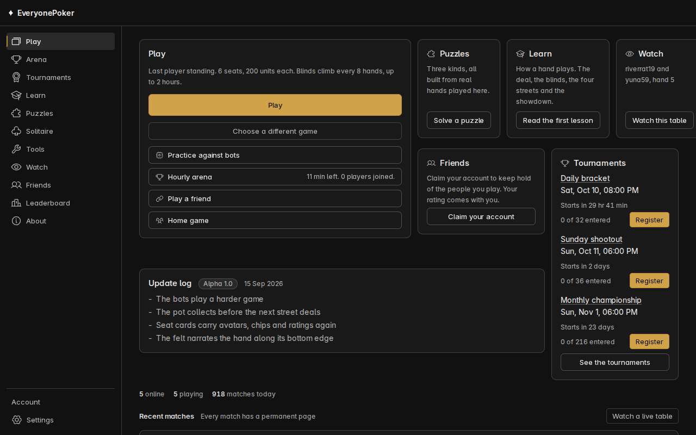

# EveryonePoker

EveryonePoker is free ranked no-limit hold'em, live at [everyonepoker.com](https://everyonepoker.com), with no money, no chips to buy and no ads. You play six-max sit and gos or heads-up matches and your rating moves with Glicko-2, while bots fill the empty seats in casual games. Every match gets its own public page with the hand histories and a shuffle you can check was fair.



## Running it

You need Node 22 and Postgres 16, and if you don't have Postgres, `docker compose up -d db` starts one from the compose file in the repo root.

```sh
cp .env.example .env
npm install
npm run dev
```

The server applies `server/db/schema.sql` when it starts and serves the client and the websocket on one port, 8130 by default. `npm test` runs the vitest suites in every workspace, and `npm run e2e -w client` builds the client and runs the Playwright specs against a preview server.

## Licence

The code is source-available under the [PolyForm Noncommercial License 1.0.0](LICENSE), so you can read it, run it and change it for any noncommercial purpose. The flag artwork is from flag-icons (MIT) and the fonts are under the SIL Open Font License, and their licence files sit next to them in `client/public`.

Required Notice: Copyright Gabriel Penman (https://gabrielpenman.com)
